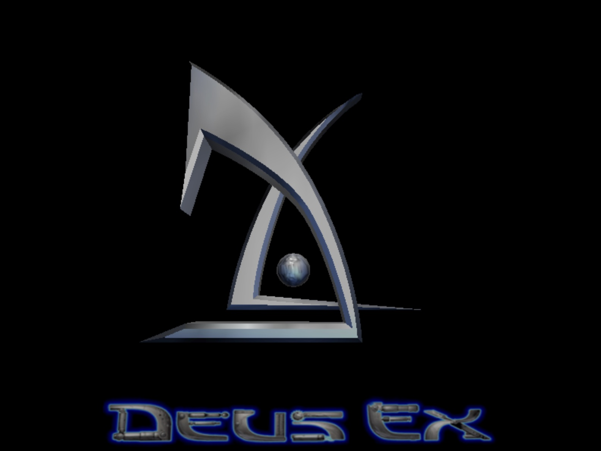
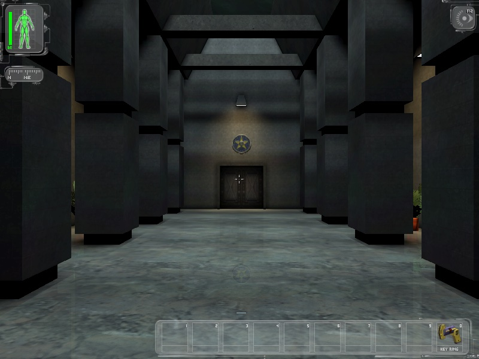
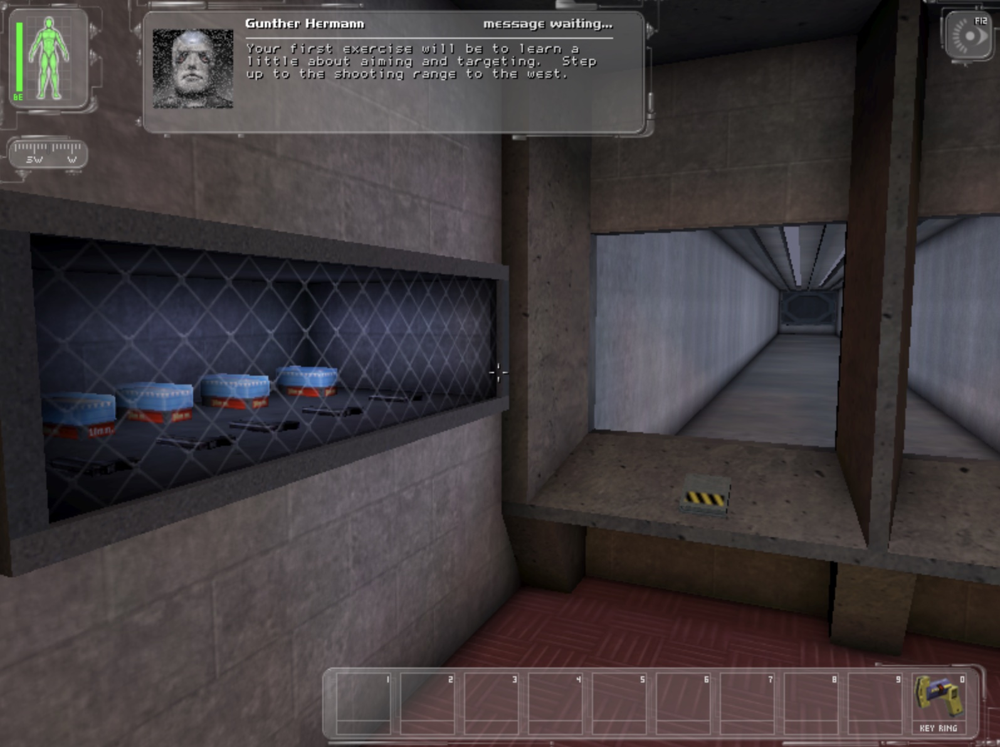
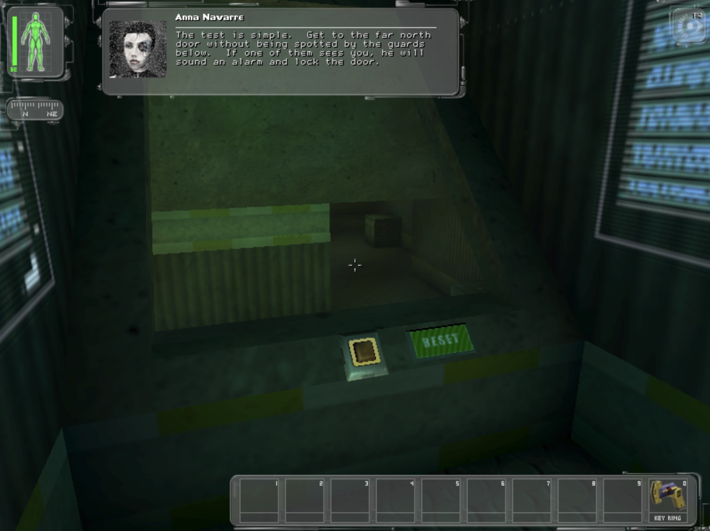
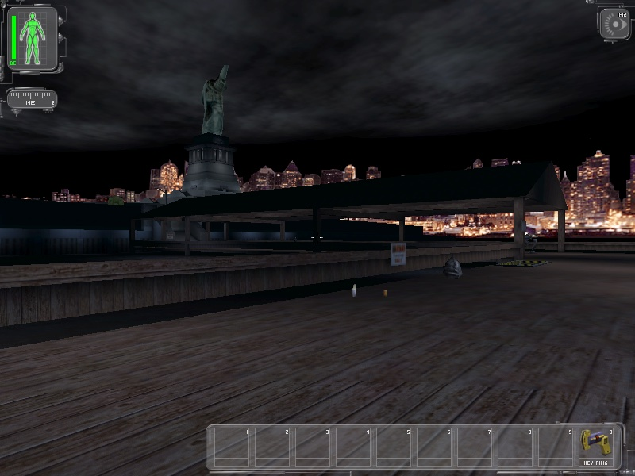
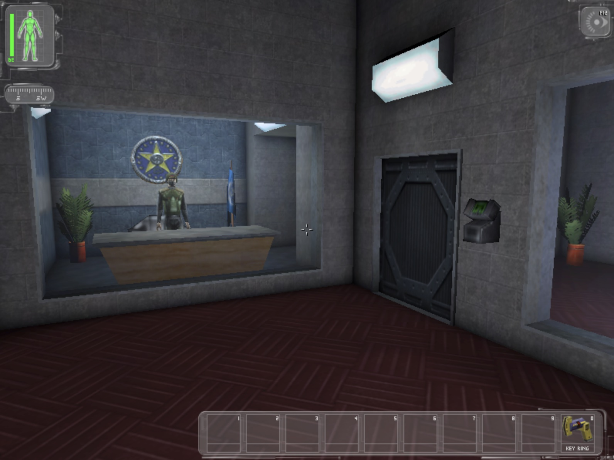

# OpenDE

An open-source reimplementation of the Deus Ex engine and UnrealEd. It runs
the original game's UnrealScript bytecode from the shipped `.u` packages on a
new C++ engine built on SDL2 and OpenGL 3.3. 


This [OpenDE-Web](https://leweyg.github.io/OpenDE-Web/) code [fork](https://github.com/leweyg/OpenDE-Web) (with PRs to merge back [rendering-optimizations](https://github.com/jarmitage99/OpenDE/pull/20) and [web-host-tuning](https://github.com/jarmitage99/OpenDE/pull/21) ) optimizes the web rendering
 and controls (for smoother frame-rate and modern laptop touchpad+keyboard, and phone/tablet single/dual touch-sticks controls, etc.), and was adapted by [Lewey Geselowitz](https://lewcid.com/lg/aboutme.html) based on the core [OpenDE](https://github.com/jarmitage99/OpenDE) project.

The original game data is required and is not included.

## Web Demo Levels

[Main Menu](https://leweyg.github.io/OpenDE-Web/static/index.html)

<a href="https://leweyg.github.io/OpenDE-Web/static/index.html"></a>

[0_0: Training: Basics](https://leweyg.github.io/OpenDE-Web/static/index.html?level=training)

<a href="https://leweyg.github.io/OpenDE-Web/static/index.html?level=training"></a>

[0_1: Training: Combat](https://leweyg.github.io/OpenDE-Web/static/index.html?level=training_combat)

<a href="https://leweyg.github.io/OpenDE-Web/static/index.html?level=training_combat"></a>

[0_2: Training: Stealth](https://leweyg.github.io/OpenDE-Web/static/index.html?level=training_final)

<a href="https://leweyg.github.io/OpenDE-Web/static/index.html?level=training_final"></a>

[1_0: New York City: Liberty Island](https://leweyg.github.io/OpenDE-Web/static/index.html?level=game)

<a href="https://leweyg.github.io/OpenDE-Web/static/index.html?level=game"></a>

[1_1: New York City: UNATCO Headquarters](https://leweyg.github.io/OpenDE-Web/static/index.html?level=unatco_hq)

<a href="https://leweyg.github.io/OpenDE-Web/static/index.html?level=unatco_hq"></a>

## Features

- Runs natively on Linux, Windows, macOS and in the browser
- Widescreen support with Hor+ field of view
- imgui-based editor
- Anisotropic filtering, trilinear filtering
- MSAA and FXAA
- Smooth lighting: bicubic filtering of lightmaps
- Detail textures visible at longer distances

## Requirements

Debian/Ubuntu with:

    $ sudo apt install build-essential cmake pkg-config libx11-dev libxext-dev libxrandr-dev libxcursor-dev libxi-dev libxss-dev libxkbcommon-dev libgl-dev libegl-dev libasound2-dev libpulse-dev libwayland-dev wayland-protocols libdecor-0-dev libssl-dev

Every other library dependency is vendored in `vendor/` and built with the project.

## Game data

Copy the contents of an installed Deus Ex (GOTY 1112fm) into `game-data/`, so
that `game-data/System`, `game-data/Maps`, `game-data/Textures`,
`game-data/Sounds` and `game-data/Music` exist. Another location can be given
at configure time with `-DDEUSEX_GAME_DATA=/path/to/deusex`.

The Deus Ex demo (version 1002f) works too, for example
`DEUSEX_GAME_DATA=demo-data build/bin/deusex`.

At runtime the game and the editor look for the data in this order: the
`DEUSEX_GAME_DATA` environment variable, a `game-data` directory next to the
executable (next to the AppImage file for AppImage builds), the Steam install
of Deus Ex (`steamapps/common/Deus Ex` in the default Steam directories and
their library folders), and finally the path given at configure time.

## Building

    $ cmake -S . -B build -DCMAKE_BUILD_TYPE=Release
    $ cmake --build build -j"$(nproc)"

Options:

- `-DSKIP_QA=ON` skips clang-format during the build.
- `-DSKIP_UT=ON` skips building the unit tests.

`scripts/check-debian.sh` builds the project in clean Debian 12 and Debian 13
containers with Docker.

### Windows

Windows builds are cross-compiled with MinGW:

    $ cmake -S . -B build-mingw -DCMAKE_TOOLCHAIN_FILE=cmake/mingw-w64-toolchain.cmake
    $ cmake --build build-mingw -j"$(nproc)"

## Browser builds

Requires Emscripten and WebGL 2. The game data given at configure time is
packaged into `index.data`, without the Windows binaries:

    $ emcmake cmake -S . -B build-web -DCMAKE_BUILD_TYPE=Release -DSKIP_UT=ON -DDEUSEX_GAME_DATA="$PWD/demo-data"
    $ cmake --build build-web --target deusex -j"$(nproc)"
    $ python3 -m http.server -d build-web/bin 8000

Then open `http://localhost:8000/`. The game data is LZ4 compressed
and cached in IndexedDB after the first download, together with settings
and saved games.

The browser shell pauses simulation and suspends audio when its tab is hidden
or loses focus. It saves once on deactivation and stops the periodic save timer
until the page is active again. Display resizing and fullscreen preserve the
game's render resolution and aspect ratio; the initial render size is 800×600.

Web Controls enables modern keyboard mappings, touch gestures, and touchpad
scroll movement. Uncheck it for Classic keyboard and mouse input. The on-screen
buttons remain available in either mode and update their key hints. They provide
Activate, Zoom, Reload, Next Item, Jump+Fwd, Recenter, Crouch, Menu, Items, and
Fullscreen. The page includes instructions for both control modes.

The shell is self-contained and uses the normal adjacent `index.js`, `index.wasm`,
and `index.data` build outputs. It contains no hosted game-data URL or game assets.
Run the browser host tests with `node --test tests/web/*.test.cjs`.

To provision a temporary Google Cloud build VM and upload this checkout:

```sh
./build_web.sh --project YOUR_PROJECT --vm opende-build --create --prepare-only
```

The defaults are Ubuntu 24.04 in `us-west1-a`, 16 vCPUs, 64 GB RAM, a 100 GB
boot disk, and automatic deletion after 24 hours. The script installs Emscripten
6.0.12 and build tools, then keeps source snapshots under
`~/build/OpenDE-Web/run.*/source`. It includes vendored dependencies and `static/`,
but excludes Git metadata, local build outputs, caches, and local credential
directories. Game data is uploaded separately when supplied.

If this checkout contains `static/deusex.data` and its matching `static/deusex.js`,
no separate game-data download is needed. The script verifies the package's
SHA-256, reads its LZ4 chunk tables and file ranges from the loader, and exports
the assets into the VM workspace's `game-data/` directory before building.
`static/scripts/unpack-web-data.py` performs this step without executing the loader;
it uses `python3-lz4`, which the VM setup installs. The older
`static/source-manifest.json` is informational, not the current chunk schema.

Build on that VM and download the verified browser bundle:

```sh
./build_web.sh --project YOUR_PROJECT --vm opende-build --game-data /path/to/demo-data
```

Omit `--game-data` to use the bundled static assets or a local data directory.
If those local assets have been removed, use
`--remote-game-data /home/USER/build/OpenDE-Web/run.PREVIOUS/game-data`
to copy an earlier VM workspace's exported assets into the new workspace.

`--game-data` is a local directory containing `System`, `Maps`, `Textures`,
`Sounds`, and `Music`; by default the script looks for `demo-data/` or `game-data/`
in this checkout. Each invocation uploads a fresh source snapshot. Successful
builds download to `build-web-local/`, verify SHA-256 checksums, and update the
matching `static/deusex.js` and `static/deusex.wasm` files. Both browser launchers
fetch game data from `https://storage.googleapis.com/demos_opende/demo_v1/deusex.data.gz`.
The build's `index.data` stays in ignored `build-web-local/`; `static/*.data` is
also ignored by Git. If game assets change, the hosted bundle must be updated
to match the generated loader before deploying it.
Use `--jobs`, `--zone`, `--machine-type`, or `--max-run-duration` to override the
defaults; the last two affect new VMs only.

The VM remains running between builds. Delete it and its boot disk when finished:

```sh
./build_web.sh --project YOUR_PROJECT --vm opende-build --delete-vm
```

This deletes only an instance labeled `purpose=opende-build`. Download anything
you need before manual deletion or the automatic deadline.

## Running

    $ build/bin/deusex

This starts at the title screen with the main menu. You can also specify a
map to be loaded `build/bin/deusex 01_NYC_UNATCOIsland`, or a path
to a `.dx` file.

Controls, settings and saves live in `~/.local/share/deusex` (`%APPDATA%\deusex`
on Windows): `DeusEx.ini` and `User.ini` are read from there when present
and otherwise from the game `System` directory, changed settings are
written there, and saved games are in `Save/`. The game data directory is
never written to. Key bindings are the original ones from `User.ini`, for
example keypad `+` for QuickSave and keypad `/` for QuickLoad.

## Multiplayer

To host, open Multiplayer in the main menu, pick LAN Game or Internet Game,
then Host Game. To join, type the host's address (`192.168.1.20` or
`192.168.1.20:7790`) into the IP Address field and press Join Game. The LAN
screen lists games on the local network.

Wont work with the original clients, OpenDE uses a new protocol. There is no
master server either so the Internet list stays empty.

From the CLI:

    $ build/bin/deusex "DXMP_Smuggler?game=DeusEx.DeathMatchGame?listen?Bots=4?Speed=150"
    $ build/bin/deusex 192.168.1.20:7790

Dedicated server:

    $ build/bin/deusex --server "DXMP_Smuggler?game=DeusEx.DeathMatchGame"

Servers use UDP port 7790, or `Port` in the `[URL]` section of `DeusEx.ini`,
or `--port`. LAN discovery uses UDP port 8777 and the port after the game
port.

## Editor

    $ build/bin/deused 01_NYC_UNATCOIsland

The editor is currently a work in progress. But it works!

## UnrealScript compiler

`ucc` exports and compiles UnrealScript, like the UCC that shipped with the
original Deus Ex SDK. Sources and compiled packages live in
`~/.local/share/deusex` and packages in `~/.local/share/deusex/System`
are loaded in place of the shipped ones with the same name.

To export the sources of a package:

    $ build/bin/ucc batchexport DeusEx.u class uc ~/.local/share/deusex/DeusEx/Classes

Compile:

    $ build/bin/ucc make

## Tests

    $ build/bin/unit-tests

Unit tests that need the game data are tagged `[data]`. You can run the ones
that dont need game data with:

    $ build/bin/unit-tests "~[data]"

The `[net]` tests run a dedicated server and two `--headless` clients as
separate processes, driven over stdin with `--control`. `DX_NET_LOSS`
(percent) and `DX_NET_LAG` (milliseconds) simulate a bad link.

## Thanks

This project would not be possible without the incredible work from these
legends:

- gildor
- dpJudas
- jmarshall
- AnthraX
- Marco888
